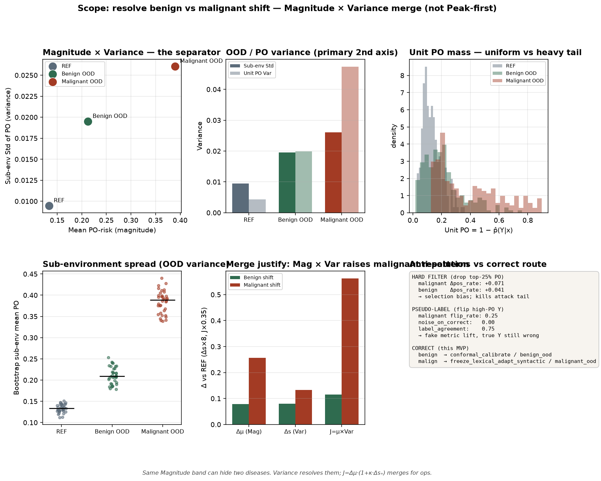

# Magnitude × Variance — benign vs malignant shift

## Scope

Raise resolution between benign vs malignant *shift* when both raise mean OOD/PO. Not a generic OOD detector; Peak is not the headline.

## Justify (merge)

Merge Magnitude × Variance: Δμ quiet → hold; Δμ↑ & Δs flat → benign shift → conformal; Δμ↑ & Δs↑ → malignant shift → freeze-lexical. J=Δμ·(1+κ·Δs₊) amplifies variance-resolved malignant.

- **Same:** Both shifts can raise Magnitude (mean PO / OOD)
- **Diff:** Only malignant raises sub-env Variance enough to resolve the two

## Separation panel

| batch | magnitude μ | variance s | J (merge) | verdict | route |
| --- | --- | --- | --- | --- | --- |
| ref | 0.1332 | 0.0095 | 0.0000 | quiet | hold |
| benign_ood | 0.2123 | 0.0195 | 0.3308 | benign_ood | conformal_calibrate |
| malignant_ood | 0.3899 | 0.0261 | 1.6078 | malignant_ood | freeze_lexical_adapt_syntactic |

## Anti-patterns

Do **not** hard-filter high-PO rows or pseudo-label flips from PO.
See also `docs/method/AS_DTA_magnitude_variance_logic.md`.



```bash
python3 scripts/run_as_dta_benign_malignant_mvp.py
```
