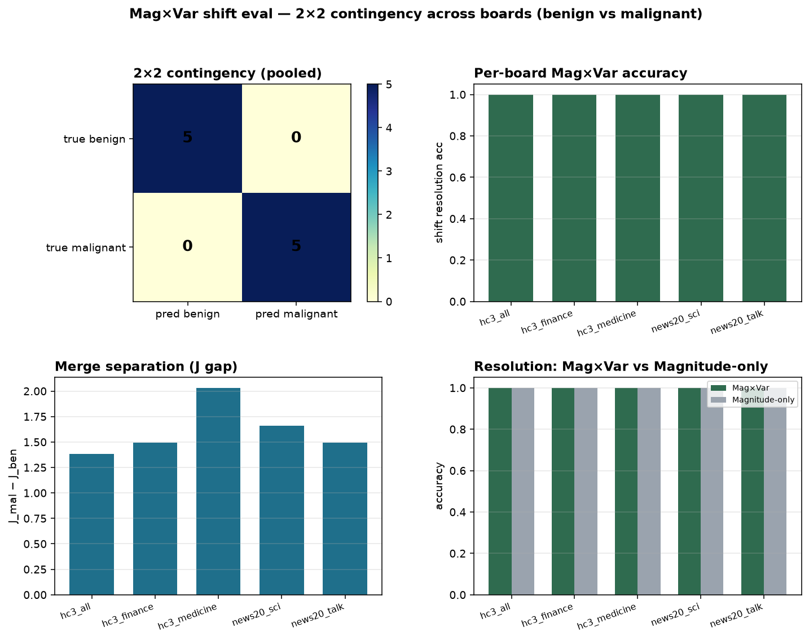

# Mag×Var multi-board eval

## Scope

2×2 contingency: true {benign, malignant} × pred {benign, malignant}.
Raise resolution between shifts that share mean OOD↑ — not Peak-first.

## Metrics list

- `contingency_2x2`
- `accuracy`
- `balanced_accuracy`
- `malignant_recall`
- `malignant_precision`
- `benign_recall`
- `J_gap`
- `d_mu_benign`
- `d_mu_malignant`
- `d_s_benign`
- `d_s_malignant`
- `magnitude_only_acc`

## Pooled 2×2

|  | pred benign | pred malignant |
| --- | --- | --- |
| **true benign** | 5 | 0 |
| **true malignant** | 0 | 5 |

pooled accuracy=1.00  bal_acc=1.00  mal_recall=1.00  J_gap(mean)=1.612

## Per board

| board | acc | J_gap | d_s ben | d_s mal | mag-only acc |
| --- | --- | --- | --- | --- | --- |
| hc3_all | 1.00 | 1.383 | 0.0089 | 0.0193 | 1.00 |
| hc3_finance | 1.00 | 1.493 | 0.0072 | 0.0228 | 1.00 |
| hc3_medicine | 1.00 | 2.032 | 0.0075 | 0.0237 | 1.00 |
| news20_sci | 1.00 | 1.658 | 0.0120 | 0.0241 | 1.00 |
| news20_talk | 1.00 | 1.493 | 0.0157 | 0.0219 | 1.00 |

## Landing (OOD Mag×Var)

- AIGC moderation — route conformal vs freeze (HC3 verticals)
- Trust & safety text — topic/domain synonym drift vs adversarial paraphrase
- Content integrity — industrial vertical transfer (finance/medicine)
- Uplift / RL monitors — Mag×Var as stratum before actuator spend
- API gateway — per-channel Mag×Var gate without full retrain



```bash
python3 scripts/run_as_dta_mag_var_boards.py
```
