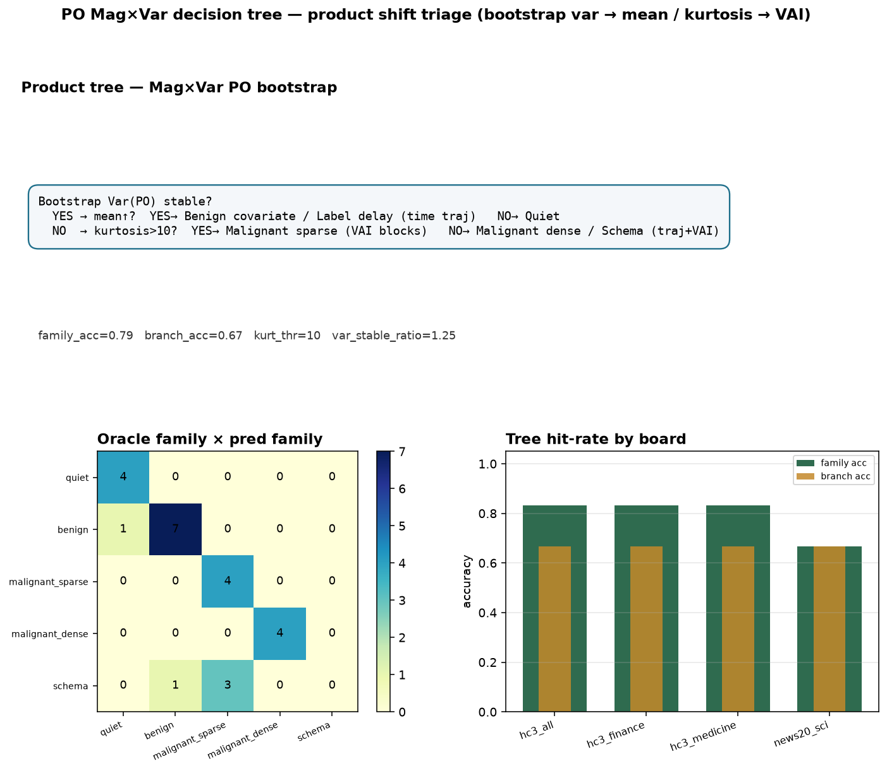

# PO Mag×Var product decision tree

var stable? → mean↑? → benign/label_delay/quiet; else kurtosis>10? → malignant_sparse : malignant_dense/schema

## Product use case

**Shift triage gate for integrity / moderation / ranking monitors**

One bootstrap Mag×Var panel replaces 'OOD high ⇒ retrain'. Stable-var mean lifts get cheap conformal; kurtotic sparse attacks get VAI-guided freeze; dense/schema get heavier review.

## Effect

- mean family accuracy: **0.79**
- mean branch accuracy: **0.67**

| board | family_acc | branch_acc |
| --- | --- | --- |
| hc3_all | 0.83 | 0.67 |
| hc3_finance | 0.83 | 0.67 |
| hc3_medicine | 0.83 | 0.67 |
| news20_sci | 0.67 | 0.67 |



```bash
python3 scripts/run_as_dta_po_decision_tree.py
```
