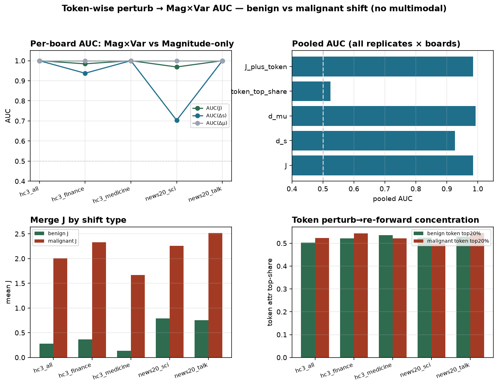

# Token Mag×Var AUC — benign vs malignant shift

Token-wise perturb→re-forward + Mag×Var AUC to separate benign vs malignant shift (no multimodal).

## Logic

1. PO_i = 1 - p̂(Y_i|x_i)
2. Magnitude μ, Variance s of sub-env mean PO
3. Token attr a_j = |PO^{drop j} - PO| after re-forward
4. Score J = Δμ·(1+κ·Δs₊); AUC malignant vs benign

## Pooled AUC

- **J**: 0.984
- **d_s**: 0.926
- **d_mu**: 0.993
- **token_top_share**: 0.524
- **J_plus_token**: 0.984

## Per board AUC(J)

| board | AUC(J) | AUC(Δs) | AUC(Δμ) | AUC(token) |
| --- | --- | --- | --- | --- |
| hc3_all | 1.000 | 1.000 | 1.000 | 0.703 |
| hc3_finance | 0.984 | 0.938 | 1.000 | 0.562 |
| hc3_medicine | 1.000 | 1.000 | 1.000 | 0.391 |
| news20_sci | 0.969 | 0.703 | 1.000 | 0.188 |
| news20_talk | 1.000 | 1.000 | 1.000 | 0.594 |

## Justify

Magnitude alone confuses uniform synonym with attack when both raise μ. Variance of PO + token-attr concentration rises under malignant subset triggers; AUC of J / d_s justifies separation across datasets.



```bash
python3 scripts/run_as_dta_token_magvar_auc.py
```
